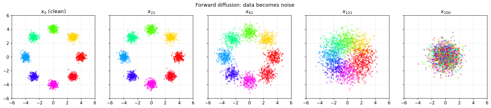
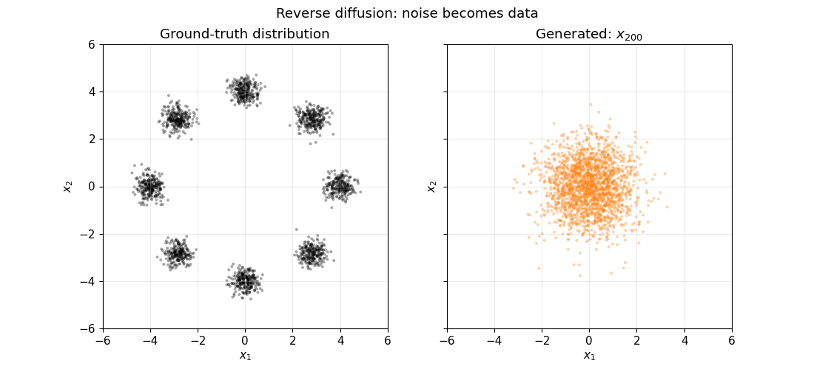

# Generative Models from First Principles

This repository is a notebook-based introduction to five major generative-model families: variational autoencoders (VAEs), normalizing flows (NFs), autoregressive models (AMs), generative adversarial networks (GANs), and diffusion models (DMs). Each family is first made visible on the same two-dimensional "Ring of Gaussians" (RoG) experiment and then scaled to MNIST. The final notebooks deepen diffusion sampling and conditioning before a no-retraining synthesis activity.

<picture>
  <source media="(prefers-color-scheme: dark)" srcset="assets/diffusion_rog_forward-dark-mode.png">
  <source media="(prefers-color-scheme: light)" srcset="assets/diffusion_rog_forward-light-mode.png">
  
</picture>

<picture>
  <source media="(prefers-color-scheme: dark)" srcset="assets/diffusion_rog_reverse-dark-mode.gif">
  <source media="(prefers-color-scheme: light)" srcset="assets/diffusion_rog_reverse-light-mode.gif">
  
</picture>

## Intended audience

The material is intended for advanced undergraduate or graduate students, engineers, and researchers who know basic machine learning and want to connect generative-model equations to compact PyTorch implementations. The notebooks favor inspectable, from-scratch components over framework abstractions and production-scale performance.

## How to use this material

For the most educational value, run the notebooks step by step in a Jupyter environment rather than only reading the rendered notebooks on GitHub. Executing the cells interactively makes it easier to inspect intermediate results, experiment with the code, connect each implementation step to the theory, and answer the self-check questions and exercises in the last notebook without spoilers.

## Prerequisites

You should be comfortable with:

- Python functions, classes, loops, and array indexing;
- NumPy-style tensor operations and basic PyTorch training loops;
- probability concepts including densities, conditional probability, expectation, Gaussian distributions, and KL divergence;
- multivariable calculus, gradients, the chain rule, and Jacobians;
- basic neural-network ideas such as backpropagation, convolution, normalization, and train/validation evaluation;
- reading mathematical notation. Familiarity with maximum likelihood and variational inference is helpful but not required.

Use Python 3.10 - 3.13. A CUDA-capable GPU is optional for the ring notebooks and synthesis activity, but recommended for training the bigger MNIST models. CPU execution remains useful for reading, shape checks, and checkpoint-backed demonstrations.

## Setup and launch from the repository root

The environment is specified in `pyproject.toml`.

```bash
python -m venv .venv
source .venv/bin/activate
python -m pip install --upgrade pip
python -m pip install -e ".[dev]"
jupyter lab --notebook-dir=notebooks
```

Run these commands within the repository root. Setting the Jupyter notebook directory to `notebooks/` also keeps the notebooks' relative `data/` and `checkpoints/` paths aligned. Open notebooks through the Jupyter file browser and use **Kernel > Restart Kernel and Run All Cells** for a full run.

To install only runtime dependencies, use `python -m pip install -e .`. PyTorch's default wheel is suitable for CPU use on supported platforms. For a particular CUDA runtime, install the matching PyTorch build using the official [PyTorch selector](https://pytorch.org/get-started/locally/), then install this project.

## Recommended sequence

Follow the numbered order on a first pass:

1. [VAE on a ring of Gaussians](notebooks/01_vae_ring_of_gaussians.ipynb)
2. [Normalizing flow on a ring of Gaussians](notebooks/02_normalizing_flow_ring_of_gaussians.ipynb)
3. [Autoregressive density model on a ring of Gaussians](notebooks/03_autoregressive_ring_of_gaussians.ipynb)
4. [GAN on a ring of Gaussians](notebooks/04_gan_ring_of_gaussians.ipynb)
5. [Diffusion model on a ring of Gaussians](notebooks/05_diffusion_ring_of_gaussians.ipynb)
6. [Convolutional VAE on MNIST](notebooks/06_vae_mnist.ipynb)
7. [Multiscale Glow on MNIST](notebooks/07_normalizing_flow_mnist.ipynb)
8. [Autoregressive image Transformer on MNIST](notebooks/08_autoregressive_mnist.ipynb)
9. [Spectral-normalized ResNet GAN on MNIST](notebooks/09_gan_mnist.ipynb)
10. [DDPM on MNIST](notebooks/10_diffusion_mnist.ipynb)
11. [Diffusion samplers on MNIST](notebooks/11_diffusion_sampling_mnist.ipynb)
12. [Conditional diffusion with classifier-free guidance](notebooks/12_diffusion_conditional_mnist.ipynb)
13. [Compare generative models](notebooks/13_compare_generative_models.ipynb)

For a shorter conceptual path, complete notebooks 01 - 05, inspect checkpoint-backed results in 06 - 12, and finish with notebook 13. Notebook 11 depends conceptually and operationally on notebook 10's denoiser model. Notebook 12 uses a separate conditional checkpoint.

## Course map

| Phase | Notebooks | Guiding questions | Main artifacts |
|---|---|---|---|
| Shared 2D laboratory | [01](notebooks/01_vae_ring_of_gaussians.ipynb), [02](notebooks/02_normalizing_flow_ring_of_gaussians.ipynb), [03](notebooks/03_autoregressive_ring_of_gaussians.ipynb), [04](notebooks/04_gan_ring_of_gaussians.ipynb), [05](notebooks/05_diffusion_ring_of_gaussians.ipynb) | What objective does each family optimize? What does it make easy or difficult? How does each model cover eight modes? | Density plots, latent geometry, decision surfaces, reverse trajectories, and shared sample diagnostics |
| Scale to images | [06](notebooks/06_vae_mnist.ipynb), [07](notebooks/07_normalizing_flow_mnist.ipynb), [08](notebooks/08_autoregressive_mnist.ipynb), [09](notebooks/09_gan_mnist.ipynb), [10](notebooks/10_diffusion_mnist.ipynb) | Which ideas survive the move from 2D to pixels? Which architectural and computational trade-offs appear? | Convolutional VAE, Glow, causal image Transformer, ResNet GAN, and U-Net DDPM checkpoints |
| Diffusion extensions | [11](notebooks/11_diffusion_sampling_mnist.ipynb), [12](notebooks/12_diffusion_conditional_mnist.ipynb) | How much does the sampler matter when the denoiser is fixed? How does guidance trade diversity for condition adherence? | DDPM/DDIM/DPM-Solver++ comparison and classifier-free guidance sweep |
| Synthesis | [13](notebooks/13_compare_generative_models.ipynb) | How should model choice follow the task, constraints, and evaluation evidence? | Retrieval practice, comparison matrix, scenarios, metric critique, and exit ticket |

## Runtime, hardware, and checkpoint guide

Runtimes can vary substantially with hardware, PyTorch version, rendering, and whether outputs are regenerated. “Load” assumes the tracked checkpoint is available and the notebook's `RUN_MODE` is set to `"lecture"` where applicable.

| # | Notebook | Typical full-run cost | Practical hardware | Checkpoint/data behavior |
|---:|---|---|---|---|
| 01 | [VAE, ring](notebooks/01_vae_ring_of_gaussians.ipynb) | Short: usually under a few minutes | CPU is sufficient; GPU optional | Trains in memory; no checkpoint |
| 02 | [Flow, ring](notebooks/02_normalizing_flow_ring_of_gaussians.ipynb) | Short: usually under a few minutes | CPU is sufficient; GPU optional | Trains in memory; no checkpoint |
| 03 | [Autoregressive, ring](notebooks/03_autoregressive_ring_of_gaussians.ipynb) | Short: usually under a few minutes | CPU is sufficient; GPU optional | Trains in memory; no checkpoint |
| 04 | [GAN, ring](notebooks/04_gan_ring_of_gaussians.ipynb) | Short: usually under a few minutes | CPU is sufficient; GPU optional | Trains in memory; no checkpoint |
| 05 | [Diffusion, ring](notebooks/05_diffusion_ring_of_gaussians.ipynb) | Short: usually under a few minutes | CPU works; GPU improves reverse-process visualizations | Trains in memory; no checkpoint |
| 06 | [VAE, MNIST](notebooks/06_vae_mnist.ipynb) | Moderate; on GPU about 1 minute | GPU recommended; CPU feasible but slower | Trains each full run; uses cached MNIST files |
| 07 | [Glow, MNIST](notebooks/07_normalizing_flow_mnist.ipynb) | Long if retrained; short when loading | GPU strongly recommended; CPU mainly for inspection | Defaults to `RUN_MODE="lecture"`, which loads `glow_mnist.pt`; use `"full"` to retrain |
| 08 | [Image Transformer, MNIST](notebooks/08_autoregressive_mnist.ipynb) | Long if retrained; sampling is sequential even after loading | GPU strongly recommended; generation remains noticeably slower | Defaults to `RUN_MODE="lecture"`, which loads `image_transformer_mnist.pt`; use `"full"` to retrain |
| 09 | [ResNet GAN, MNIST](notebooks/09_gan_mnist.ipynb) | Long if retrained; one-pass sampling is fast | GPU strongly recommended | Defaults to `RUN_MODE="lecture"`, which loads `resnet_gan_mnist.pt`; use `"full"` to retrain |
| 10 | [DDPM, MNIST](notebooks/10_diffusion_mnist.ipynb) | Moderate/long; iterative sampling | GPU strongly recommended | Defaults to `RUN_MODE="lecture"`, which loads `ddpm_mnist.pt`; use `"full"` to retrain |
| 11 | [Diffusion sampling, MNIST](notebooks/11_diffusion_sampling_mnist.ipynb) | Moderate: no denoiser training, but several sampler sweeps | GPU recommended; CPU can be slow for repeated reverse steps | Requires `ddpm_mnist.pt`; can use or create `mnist_evaluator.pt` |
| 12 | [Conditional diffusion, MNIST](notebooks/12_diffusion_conditional_mnist.ipynb) | Moderate/long; iterative sampling | GPU strongly recommended | Defaults to `RUN_MODE="lecture"`, which loads the separate `ddpm_mnist_cfg.pt`; use `"full"` to retrain |
| 13 | [Synthesis activity](notebooks/13_compare_generative_models.ipynb) | Lightweight: roughly 30 - 60 minutes of reading and discussion | Any machine; no accelerator needed | No data, checkpoint, training, or expensive execution |

## Model families at a glance

“Exact likelihood” below means a normalized data likelihood that is directly tractable for the stated model, not merely a trainable surrogate or an estimate.

| Family | Typical training objective | Exact likelihood? | Training parallelism | Sampling parallelism | Reconstruction / inversion | Strengths | Common failure modes or costs |
|---|---|---|---|---|---|---|---|
| VAE | Maximize an ELBO: reconstruction log likelihood minus posterior-to-prior KL | No; the ELBO lower-bounds a usually intractable marginal likelihood | Parallel across examples and latent dimensions | Parallel, usually one decoder pass | Fast approximate reconstruction through the encoder; not exact inversion | Stable training, useful latent representation, interpolation, fast sampling | Posterior collapse, prior/aggregate-posterior mismatch, over-smoothed samples under simple likelihoods |
| Normalizing flow | Exact maximum likelihood via change of variables | Yes, for continuous data under the chosen dequantization/model assumptions | Parallel for coupling-based flows, subject to architecture | Parallel for coupling-based flows; one inverse pass through layers | Exact bijective inversion and reconstruction up to numerical precision | Exact density, latent access, controllable sampling temperature | Invertibility constrains architecture and dimensionality; Jacobian/memory cost; likelihood may not track perception |
| Autoregressive | Exact maximum likelihood from a product of conditionals | Yes, for the chosen ordering and output distribution | Teacher-forced likelihood terms can be evaluated in parallel, although causal computation is costly | Sequential over dimensions/tokens; samples in a batch are parallel | No compact latent inverse; supports likelihood scoring and prefix completion | Strong density estimation, simple normalized factorization, flexible conditionals | Slow generation, ordering dependence, exposure to early sampling errors, quadratic attention cost in Transformers |
| GAN | Adversarial discriminator/critic and generator objectives | No | Parallel minibatch training, but alternating networks interact | Highly parallel; usually one generator pass | No native inverse or reconstruction; requires an added encoder or optimization | Sharp samples, fast generation, flexible implicit distributions | Mode dropping/collapse, unstable dynamics, difficult comparison, no likelihood-based coverage guarantee |
| Diffusion | Denoising score/noise-prediction objective related to a variational bound | Not directly in the standard formulation; bounds and specialized estimators exist | Parallel across examples and independently sampled noise levels | Parallel across a batch but sequential across denoising steps | Forward noising is known; exact sample reconstruction/inversion is not native, while deterministic inversion methods are approximate/model-dependent | Stable objective, strong coverage and sample quality, flexible conditioning and guidance | Slow iterative sampling, high compute, schedule/solver sensitivity, guidance can reduce diversity or amplify artifacts |

Two cautions follow from this table. First, architecture and scale can move the practical speed/quality frontier within every family. Second, likelihood, perceptual quality, diversity, reconstruction, and controllability are different axes; no single column identifies a universal winner.

## Data and checkpoint notes

- The compressed MNIST IDX files are tracked under `notebooks/data/mnist/`. The MNIST notebooks can also download missing files from the public source using Python's standard library.
- Teaching checkpoints are tracked under `notebooks/checkpoints/` so the computationally heavier notebooks can be demonstrated without retraining.
- Checkpoint-aware notebooks 07 - 10 and 12 default to `RUN_MODE="lecture"`, which derives `TRAIN=False` and loads the tracked full checkpoint. Set `RUN_MODE="full"` for full training or `RUN_MODE="smoke"` for a reduced-cost pipeline check that trains and writes a separate smoke checkpoint.
- Notebook 11 expects the unconditional checkpoint from notebook 10. Notebook 12 cannot reuse it because classifier-free guidance adds class embeddings and label dropout during training.
- PyTorch checkpoints use pickle-based serialization. Load only checkpoints from a trusted source. The notebooks use device mapping so GPU-produced checkpoints can be restored on CPU, subject to available memory.
- Checkpoints capture model state and selected training history, not a fully pinned operating system or CUDA stack. Minor numerical and visual differences across devices are expected.
- The notebooks intentionally expose random seeds, but GPU kernels and library versions can still prevent bit-for-bit reproducibility.

## Validation for contributors

The optional development dependencies provide notebook parsing and execution utilities. Cheap structural checks can be run from the repository root without training models:

```bash
python -m compileall -q .
python -c "import pathlib, nbformat; [nbformat.read(path, as_version=4) for path in pathlib.Path('notebooks').glob('*.ipynb')]"
```

Do not use blanket “execute every notebook” validation in routine checks: notebooks 07-12 may load large checkpoints, train for hours, or run many sampling steps. Validate expensive notebooks selectively and with their documented checkpoint settings.
